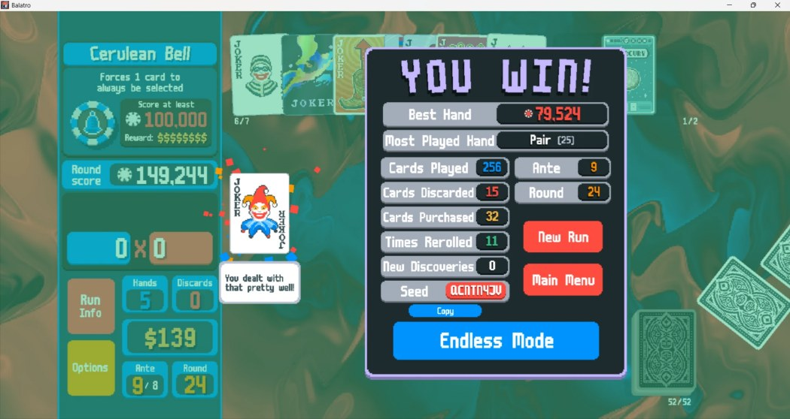
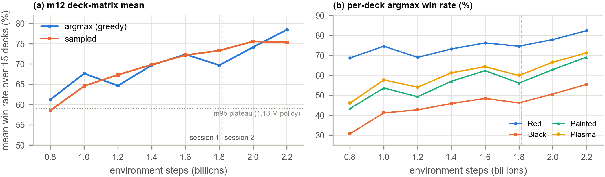
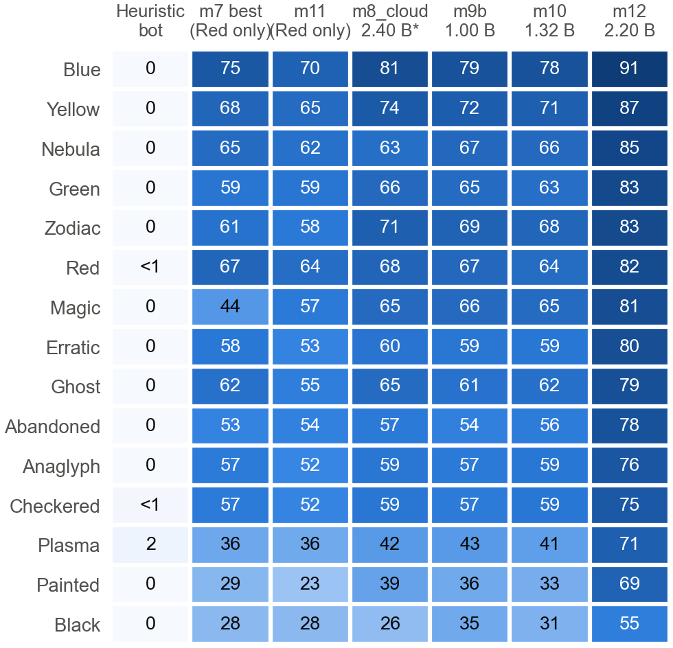
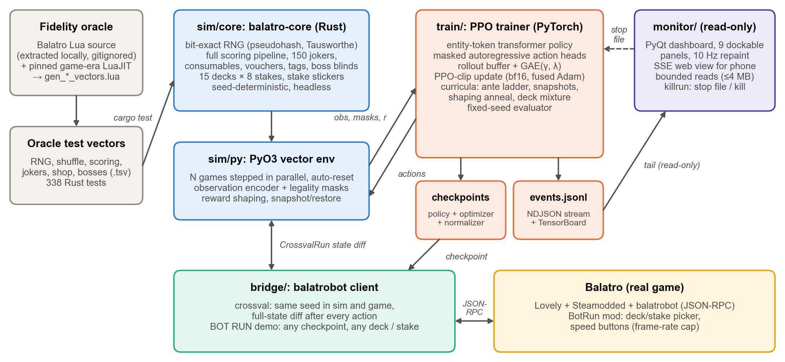
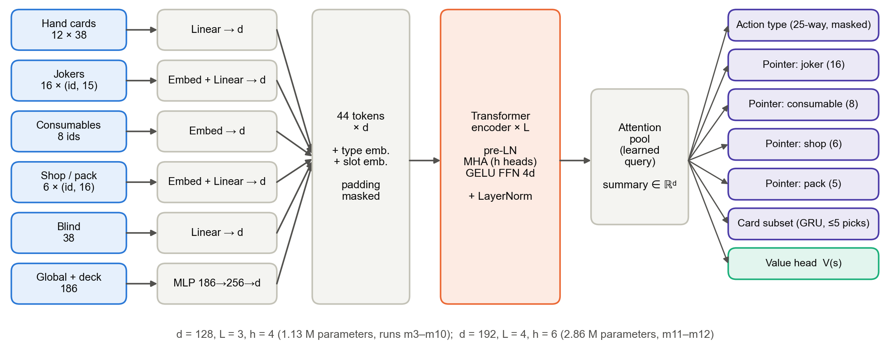
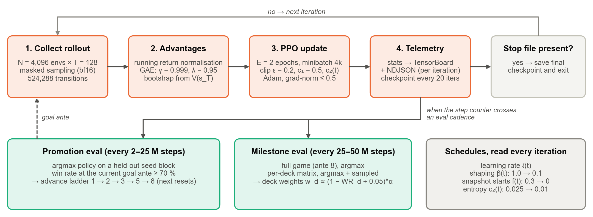
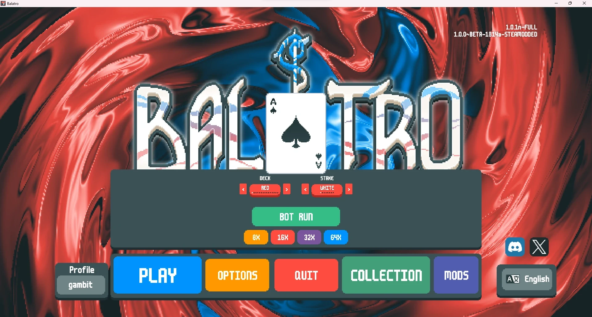
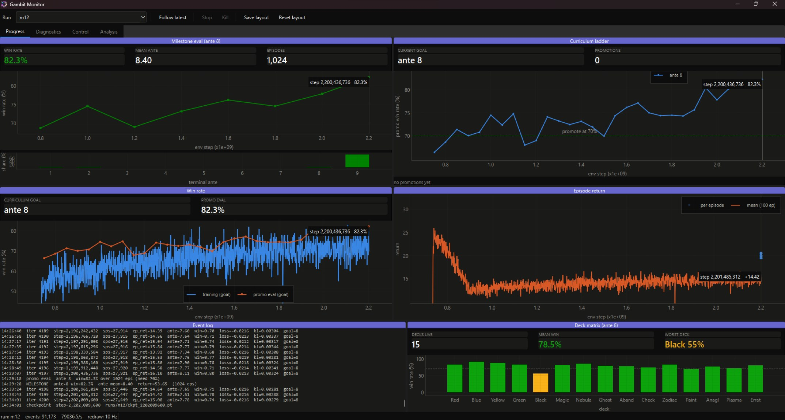
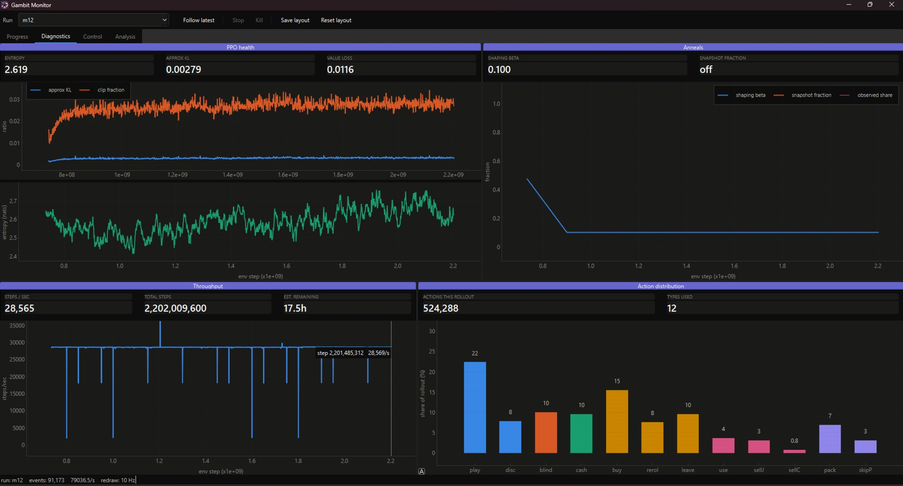

# Gambit

A reinforcement learning agent that plays [Balatro](https://www.playbalatro.com/),
built on a seed-faithful Rust simulator, a PPO training stack, and a live monitoring
and run-control layer.

**Best result (v1.0, run m12):** a 2.86M-parameter policy wins **78.5%** of ante-8 runs
averaged over all **15 decks** and **82.3%** on the Red Deck (White Stake, greedy play,
1,024 held-out seeds per deck that were never trained on). A scripted heuristic bot wins
0.1%.

<p align="center">
  
  <br><sub>The final m12 policy winning the real game (seed <code>QCNTN4JV</code>, ante-8 boss
  The Cerulean Bell beaten with 149,244 chips against 100,000).</sub>
</p>

## Milestones

| | Milestone | Run | Policy | Steps | Result |
|---|---|---|---|---|---|
| 1 | Seed-faithful simulator | `sim/` | — | — | bit-exact RNG, 15 decks × 8 stakes, 338 tests, cross-validated action-by-action against the live game; 3–15 steps/s in the real game → 5–27k steps/s in the sim |
| 2 | First full-game wins | m3_fast | 1.13M | 0–1.0B | ante ladder 1→2→3→5→8 climbed; 24% on Red* |
| 3 | Red Deck mastery | m4_branch → m7 | 1.13M | 1.0–10B | **67.3%** on 1,024 unseen seeds (m7 @ 9.15B) |
| 4 | 15-deck generalist | m8 → m10 | 1.13M | +2.4B | ~59% 15-deck mean; Black/Painted/Plasma stuck at 35/39/43% |
| 5 | Capacity | m11 | 2.86M | 0–0.7B | reaches the ante-8 rung in 153M steps (vs 854M); 63.7% on unseen Red seeds |
| 6 | **Best policy** | **m12** | **2.86M** | **0.7–2.2B** | **78.5% 15-deck mean, 82.3% Red**; Black 55%, Painted 69%, Plasma 71% |
| 7 | Live play | `bridge/` | — | — | trained checkpoints win the real game via an in-menu BOT RUN launcher |

\*logged with the original, biased evaluator (see [DECISIONS.md](DECISIONS.md), "M9").
m12 trained for two 11-hour sessions on Kaggle's free RTX PRO 6000 at ~27,500 steps/s; its
deck matrix was still rising when training stopped. The best checkpoint is
`train/runs/m12/ckpt_2202009600.pt` (run directories are gitignored).

<p align="center">
  
</p>
<p align="center">
  
  <br><sub>Greedy win rate (%) per deck: scripted bot, Red-only policies applied zero-shot,
  the 1.13M deck-mixture runs, and m12.</sub>
</p>

### What moved the needle, and what did not

- **Capacity broke the plateau.** Reweighting the deck mixture toward weak decks and raising the
  shaping reward both left the 1.13M policy at ~59%; the 2.86M policy reached 78.5%, lifting
  the three structurally different decks by 20–30 points.
- **`torch.compile` silently corrupted PPO.** The compiled rollout and update graphs disagreed
  on the policy's own probabilities (KL ≈ 1e-4 before any optimizer step, single samples with
  probability ratio 1.45, outside the clip range) and two cloud sessions diverged. Eager mode:
  KL ≈ 1e-9 for 2,800 iterations. `kl0` is now logged every iteration.
- **Update guards that tell divergence from noise.** Target-KL early stop at 0.03, plus aborts on
  mean KL > 0.1 or five consecutive early stops. A ceiling on the *largest* minibatch KL killed a
  healthy run on a single heavy-tailed estimator outlier.
- **An evaluation bias** — counting the first N episodes to *finish* — under-reported hard-deck
  win rates (a true 33% Black Deck read as 0%). Every slot now contributes exactly one episode.
- **A constant entropy bonus corrodes a converged policy** (deck mean 61.7% → 54.4%); it is now
  annealed.

The full write-up (IEEE format, with method, ablations and failure analysis) is built from
`docs/report/` (local, gitignored); the engineering log is [DECISIONS.md](DECISIONS.md).

## Architecture

<p align="center">
  
</p>

The Rust simulator, validated against oracle vectors generated from the game's own Lua source,
is stepped thousands of games at a time by the PPO trainer. The monitor only reads the event
stream; the bridge replays checkpoints on the real game and diffs both states after every
action.

<p align="center">
  
</p>

Cards, jokers, consumables and shop slots become entity tokens for a transformer encoder. The
action is composite and autoregressive: an action type, then pointer heads choose its targets
and up to five cards, each masked to legal choices, so every sampled action is legal.

<p align="center">
  
</p>

Each PPO iteration collects 4,096 × 128 transitions, computes GAE and runs the update;
held-out evaluations drive the ante-ladder promotions and the deck-sampling weights.

## Components

- **`sim/`** — a seed-faithful headless reimplementation of Balatro in Rust: bit-exact RNG
  (`pseudohash`/`pseudoseed` streams + LuaJIT's Tausworthe `math.random`), the full scoring
  pipeline, all 150 jokers, consumables, vouchers, tags, boss blinds, and all **15 decks × 8
  stakes** (deck backs, the stake modifier cascade, and the eternal/perishable/rental stickers).
  338 tests, including oracle vectors generated with a pinned game-era LuaJIT and full-state
  cross-validation against the real game. Exposed to Python as a vectorized PyO3 env (`sim/py`)
  that steps thousands of games in parallel.
- **`train/`** — a CleanRL-style PPO stack: entity-token transformer policy (1.13M or 2.86M params)
  with autoregressive masked pointer heads over a composite action space, an ante-ladder
  curriculum and a prioritised deck-mixture curriculum (sampling weighted toward the weakest
  deck), snapshot start-state mixing (backward curriculum), entropy annealing, KL update guards,
  and throughput tuning (bf16, GPU-resident buffers, auto-sized minibatches). `train/kaggle/`
  holds the notebook generator and output downloader used for m12.
- **`bridge/`** — a client for [coder/balatrobot](https://github.com/coder/balatrobot) that drives
  the *real* game for evaluation and for the cross-validation harness (`balatro-crossval`) that
  diffs sim vs. game state after every action of seeded runs. An in-menu deck/stake picker plus a
  BOT RUN button lets any checkpoint play any of the 15×8 grid live; speed buttons drive the
  game's frame rate (the actual speed lever under balatrobot's fixed-timestep patch) up to 64×.
- **`monitor/`** — a live PyQt dashboard plus a phone-checkable SSE web view, both reading the
  run's NDJSON event stream. Read-only *and* bounded-memory: start, stop or restart it mid-run
  without affecting training.

## Environment

One conda environment, `balatro`, covers the whole repo — trainer, simulator bindings, bridge and
monitor. There is no per-directory virtualenv and nothing needs a `uv run` prefix.

First-time setup (needs a Rust toolchain for the simulator bindings):

```bash
conda create -n balatro python=3.13 -y
```

```bash
conda activate balatro
```

```bash
pip install torch --index-url https://download.pytorch.org/whl/cu126
```

```bash
pip install -e train -e bridge -r requirements-monitor.txt pytest pytest-timeout
```

```bash
pip install ./sim/py
```

Torch comes from the CUDA index explicitly, and goes in **first**: the default PyPI wheel is
CPU-only on Windows, so letting `train`'s own dependency resolve it silently costs you the GPU.
That wheel is ~2.6 GB and `pip` does not resume a dropped transfer, so on a flaky connection fetch
it with a resumable client and install from the file instead:

```bash
curl -L -C - --retry 30 --retry-delay 5 --retry-all-errors -o torch.whl "https://download.pytorch.org/whl/cu126/torch-2.13.0%2Bcu126-cp313-cp313-win_amd64.whl"
```

```bash
pip install torch.whl
```

Verify with:

```bash
python -c "import torch; print(torch.__version__, torch.cuda.is_available())"
```

Rebuild the simulator bindings after any Rust change:

```bash
pip install --force-reinstall --no-deps ./sim/py
```

### Tuning throughput for your GPU

The single biggest throughput lever is `ppo.minibatch_size`, and it must be
tuned **by measurement on your actual card**, not left to the automatic probe.

Measured on a 6GB RTX 4050 laptop GPU, same run, same everything else:

| `minibatch_size` | steps/sec |
|---|---|
| 4096 | **~5,250** |
| 16384 | ~640 |

That is an **8x collapse**, and `perf.auto_minibatch: true` picks the slow one:
its probe checks whether an update step *fits* in VRAM (it measured 7,702 MiB
as fitting), not whether it runs *fast*. At 16384 the card sits at ~5.8/6.1 GB
and thrashes rather than cleanly OOMing. So `m3_fast.yaml` ships
`auto_minibatch: false` with a hand-tuned `minibatch_size: 4096`.

If you move to a different GPU, re-tune by running a few iterations at a couple
of values and comparing `charts/sps` — don't assume a bigger minibatch is
faster. On a large card (32–96 GB) a 32,768 minibatch fits and is the cloud
default; on Kaggle's RTX PRO 6000 the 2.86M policy trains at ~27,500 steps/s and
the rollout is GPU-bound, so more than 4,096 environments buys nothing.

**Leave `perf.compile` off.** On the laptop `torch.compile` was worth only ~5%
(610 → 639 steps/s), and on the 2.86M policy it made the compiled rollout and
update graphs disagree on the policy's own probabilities, which diverged
training twice (`DECISIONS.md`, "M12"). If you turn it on, watch `kl0` in the
training log: in eager mode it sits near 1e-9. It also needs Triton, which has
no official Windows build (`pip install triton-windows` works), and spends ~10
minutes compiling before the first iteration.

## Quick start

```bash
cd sim && cargo test
```

```bash
cd train && pytest
```

```bash
cd train && python -m balatro_train.ppo --config configs/m3_fast.yaml
```

```bash
cd train && tensorboard --logdir runs/
```

`train/README.md` covers the training stack, every run config and the Kaggle workflow;
`bridge/README.md` covers real-game evaluation and cross-validation.

## Playing the real game

<p align="center">
  
  <br><sub>The BotRun mod adds deck and stake pickers, a BOT RUN button and 8×–64× speed buttons.</sub>
</p>

Launch the modded game, then point the autoplay daemon at a checkpoint (or a run directory, which
uses its newest checkpoint) and press BOT RUN in the menu:

```bash
balatro-bridge-launch
```

```bash
balatro-bridge-autoplay --ckpt train/runs/m12/ckpt_2202009600.pt
```

Every action is mirrored to the game and the full states are diffed, so a live game is also a
fidelity test. Setup, including native Windows, is in `bridge/README.md`.

## Training on Kaggle

m12 ran on Kaggle's free RTX PRO 6000 (96 GB, 46 CPU cores, 30 GPU-hours a week, 12-hour
sessions). A private dataset carries a source snapshot, a prebuilt `balatro_sim` wheel and the
resume checkpoint, so a session sets up **offline in ~10 s**; the notebook stops itself after
11 hours with a final checkpoint, and refuses to start from the seed checkpoint by accident.
`train/kaggle/make_notebook.py` generates the notebook and `train/kaggle/fetch_outputs.py`
downloads a session's run directory (the Kaggle CLI saves the server's HTTP 502 pages *as* the
files, so it retries and validates each one). Steps are in `train/README.md`.

## Run directories

Each run owns a directory named after its config's `run_name`:

```
train/runs/<run_name>/
  meta.json      # git sha, hyperparams, device, trainer pid
  events.jsonl   # durable event stream
  ckpt_*.pt      # checkpoints
  events.out.*   # TensorBoard
```

The name is fixed rather than timestamped so a resumed run keeps one identity: `--resume` paths
stay valid, and TensorBoard draws one continuous curve across restarts instead of a new disconnected
run per launch.

`emit()` never blocks the training loop — it drops events rather than adding latency to the
hot path.

## Monitor

```bash
python -m monitor
```

<p align="center">
  
  <br><sub>Progress tab on m12 at 2.20B steps: Red Deck milestone 82.3%, 15-deck matrix at a 78.5% mean.</sub>
</p>
<p align="center">
  
  <br><sub>Diagnostics tab: PPO health (approximate KL ~0.003), annealing schedules, throughput and the action mix.</sub>
</p>

Panels sit in a dock area and can be dragged, resized, stacked or torn off; use **Save layout**
to keep the arrangement. Adding a chart means adding one file to `monitor/panels/` — the registry
discovers it and the shell docks it, with no other code to touch.

Four properties keep it from competing with training for resources: one shared timer repaints
everything at 10 Hz rather than 60, hidden panels skip their repaint entirely, every series is
a bounded ring buffer decimated before drawing, and reads off the event stream are capped so
attaching to a multi-gigabyte run costs tens of megabytes rather than gigabytes.

That last one is not decoration. Being read-only bounds what the monitor can *corrupt*, not what
it can *consume*, and the trainer's page-locked `pin_memory` buffers cannot be swapped out — so an
unbounded read really could OOM the GPU from a process with no CUDA in it. `DECISIONS.md`,
Phase 7 Stage 0c.

Colours come from a palette validated for colour-vision deficiency (worst adjacent pair ΔE 9.4,
all slots ≥3:1 against the surface).

### Remote view

```bash
python -m monitor.web --host 0.0.0.0
```

A single self-contained page streaming live stats over Server-Sent Events, for checking a
multi-hour run from your phone. Stdlib only — no dependency and no JS toolchain. Read-only by
construction: no route writes, and the kill switch is deliberately not exposed over the network.
Binds to localhost unless you pass `--host`.

### Stopping a run

Stop is cooperative — the trainer writes a final checkpoint and exits at the next iteration
boundary. Kill is terminate-based, for when that is not enough.

```bash
python -m balatro_train.tools.killrun --stop
```

```bash
python -m balatro_train.tools.killrun --kill
```

## A note on game code and assets

Balatro is © LocalThunk, published by Playstack. This project is an independent, noncommercial
research/educational effort with **no affiliation to or endorsement by** either. The repo contains
**no game code or assets** (no art, audio, fonts, or shaders); the screenshots above are of the
game running with the project's mod, shown for documentation:

- The simulator is a clean-room-style *reimplementation* (each behavior cites the game source
  location it mirrors, but the code is original Rust).
- The Lua oracle harnesses used to generate some test vectors replicate game functions verbatim and
  are therefore **excluded from this repository** (gitignored, local-only), as is the extracted game
  source they validate against. The generated numeric test vectors (`sim/core/tests/data/*.tsv`) are
  included.
- To work on sim fidelity you need to own Balatro (the source ships inside the game's executable —
  see `CLAUDE.md`). The simulator is headless — no UI, art, or content — and is not a substitute for
  the game; if you want to play Balatro, [buy it](https://www.playbalatro.com/).
- If you are the rights holder and have any concern about this repository, please open an issue and
  it will be addressed promptly.

See [DECISIONS.md](DECISIONS.md) for the engineering log — what was tried, what was measured, and
why each choice was made.

## License

MIT — see [LICENSE](LICENSE).
